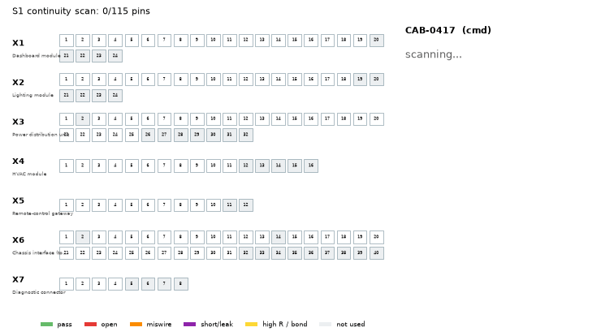
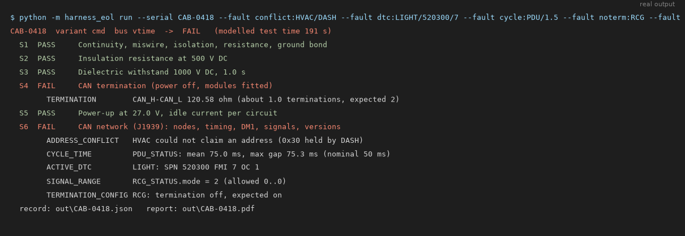
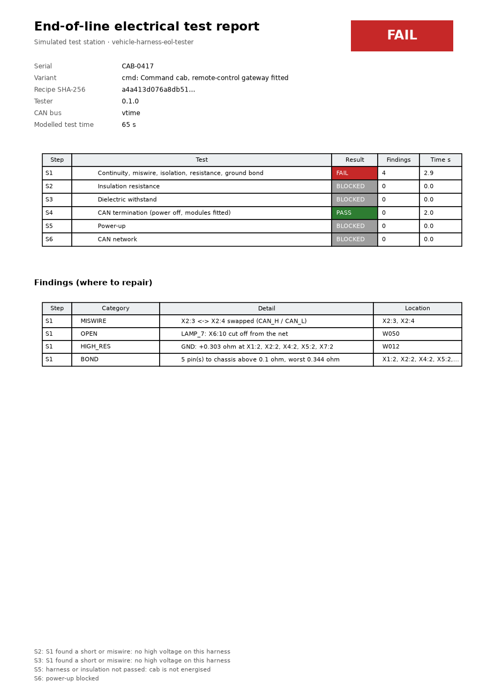
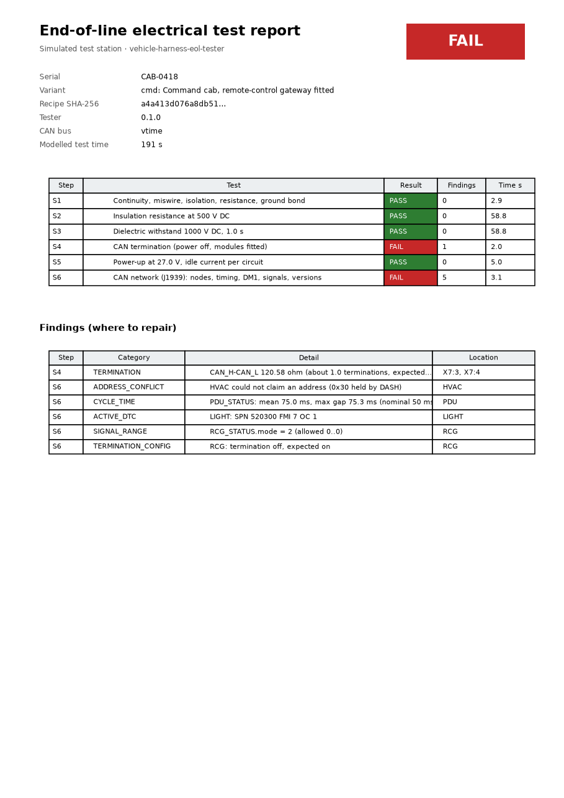
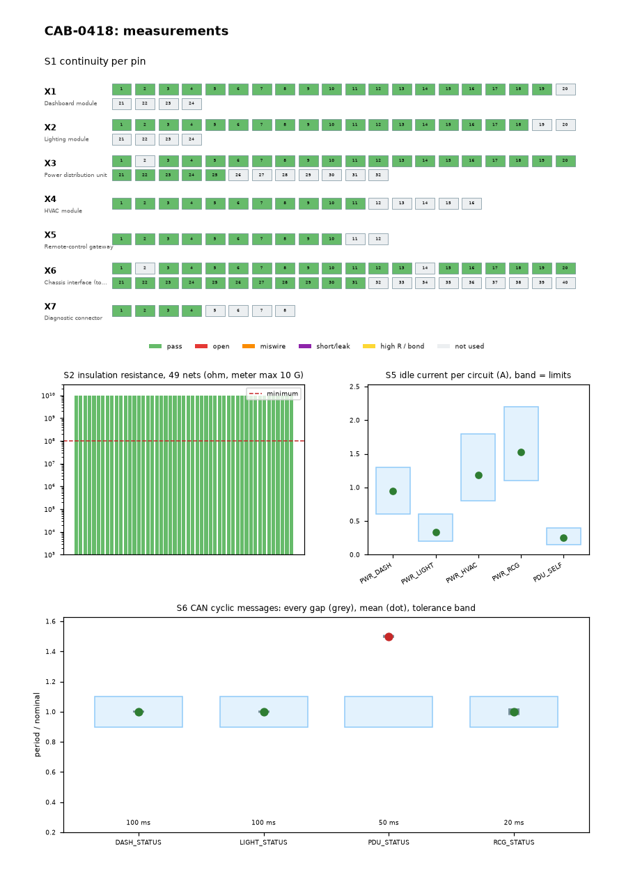
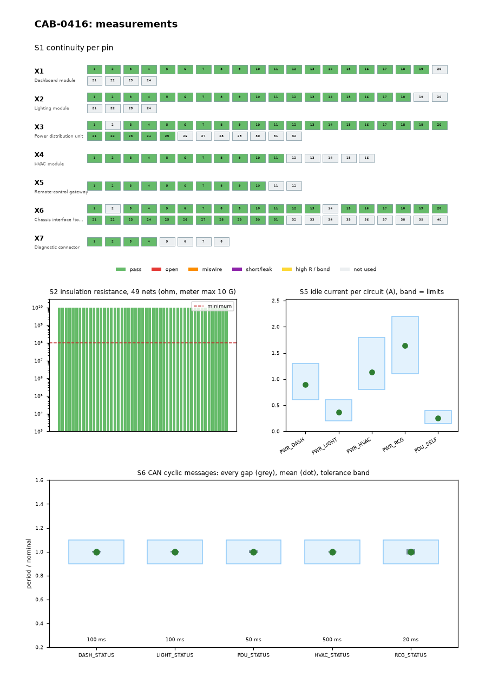
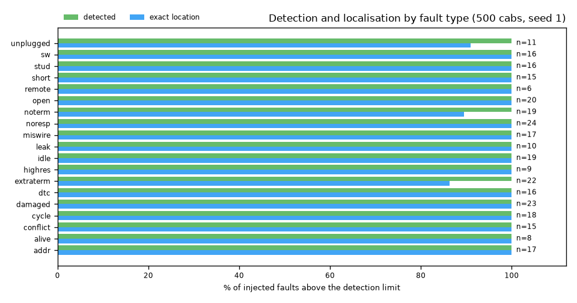
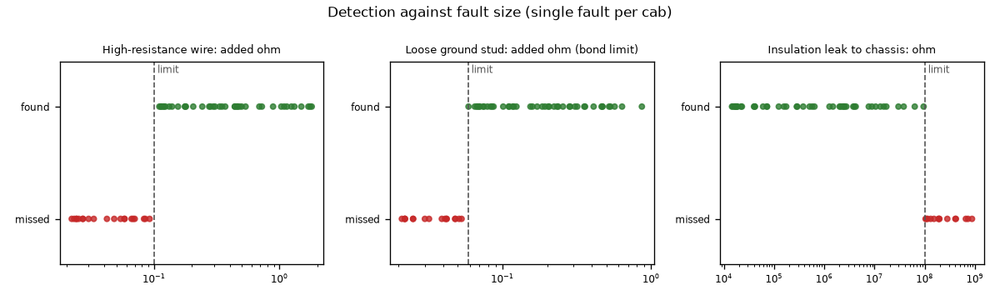
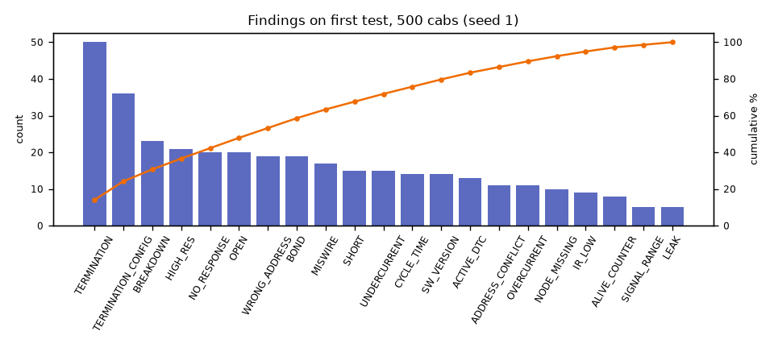

# vehicle-harness-eol-tester

[](https://github.com/chad416/vehicle-harness-eol-tester/actions/workflows/ci.yml)

This is an end-of-line electrical test station for a vehicle cab, built in simulation. It checks two things:
- **The bare harness against its 2D schematic:** continuity, miswires, shorts, wire resistance, ground bonds, insulation resistance and dielectric withstand.
- **The cab with its control modules fitted:** CAN termination, power-up current and a J1939-style network check (address claim, cyclic timing, DM1 faults, signal plausibility and software versions).

Every serial gets a report that says **where to repair**: which wire, which pin pair, or which module. Interlocks stop high voltage or power going onto a cab that has failed an earlier step.

Everything here is simulated: the harness is a resistor network, the instruments add noise, and the control units are software. Section 9 lists the limits.



*A cab with three injected faults. The scan finds CAN_H/CAN_L swapped at the lighting module (X2:3 ↔ X2:4), an open lamp wire (W050) and a high-resistance ground wire (W012). It then blocks insulation, hi-pot, power-up and CAN on this cab.*

## 1. Quick start

```bash
pip install -r requirements.txt
python -m harness_eol run --serial CAB-0001                       # good cab -> PASS, out/CAB-0001.pdf + .json
python -m harness_eol run --serial CAB-0002 --fault miswire:X1:3/X1:4 --fault dtc:HVAC/520200/3
python -m harness_eol run --serial CAB-0003 --bus virtual         # CAN step on a python-can bus (any OS)
python -m harness_eol run --serial CAB-0004 --bus socketcan:vcan0 # CAN step on SocketCAN (Linux)
python -m harness_eol batch --n 100 --seed 1                      # 100 random cabs: test -> repair -> retest
python -m harness_eol faults                                      # the fault catalogue
python -m pytest                                                  # 82 tests
```



## 2. What one cab goes through

| Step | Test | Limit (recipe) | Finds |
|---|---|---|---|
| S1 | Continuity scan of all 115 pins + the chassis, 4-wire resistance against the netlist, ground bond | connected < 10 Ω, isolated > 100 kΩ, excess ≤ 0.10 Ω, bond ≤ 0.10 Ω | open (and which wire), miswire (which pin pair), short, resistive leak, high-resistance crimp (which wire), loose ground stud |
| S2 | Insulation resistance: each net against everything else at 500 V DC | ≥ 100 MΩ | insulation leak, pinched wire |
| S3 | Dielectric withstand at 1000 V DC for 1 s | no breakdown, ≤ 1 mA | damaged insulation that still passes at 500 V |
| S4 | CAN_H–CAN_L at the diagnostic connector, power off, modules fitted | 60 Ω ± 10 % | missing or extra termination |
| S5 | Power-up at 27 V, idle current per distribution circuit | band per module | module not fitted, faulty module |
| S6 | J1939 network (more below) | recipe + DBC | addressing, timing, DTCs, signals, software versions |

S6 covers the following:
- **Address claim.** Every node is expected at its address, with the right NAME function. Conflicts are settled by NAME, and the loser sends Cannot Claim.
- **Cyclic messages.** The mean period and the longest gap are checked against `GenMsgCycleTime` in the [DBC](data/protocol/cab.dbc).
- **DM1.** Active DTCs are read, with SPN, FMI and OC.
- **Signal plausibility.** The remote-control gateway must report LOCAL mode with its e-stop chain closed, there must be no breaker trips, and similar checks.
- **Alive counter.** The gateway's alive counter must keep counting.
- **GET_VERSION.** A destination-specific GET_VERSION request (proprietary A) returns the software version and the module's termination setting. That setting turns a "bus has 1 terminator" reading into "module RCG has termination off".

**Interlocks (F09):**
- No high voltage after a short or miswire.
- No power-up unless S1–S3 pass.
- No CAN check after an overcurrent.

A blocked step says `BLOCKED` and why. It never says `PASS`.

**What the tester knows comes from data, not code:**
- [`connectors.csv`](data/variants/cmd/connectors.csv) and [`netlist.csv`](data/variants/cmd/netlist.csv): one row per wire, as a wiring-CAD export would give.
- [`recipe.yaml`](data/variants/cmd/recipe.yaml): the limits, the expected nodes and the signal ranges.

There are two variants:
- `cmd`: 78 wires, 50 nets, 154 m, and a remote-control gateway.
- `base`: 66 wires, 43 nets, 130 m, no gateway, with the bus terminated in the HVAC module.

## 3. The report

Each serial produces `out/<serial>.json` (the machine-readable record) and a 2-page PDF.

| Harness faults: S1 fails, the rest is blocked | Network faults: S4 and S6 fail |
|---|---|
|  |  |

Page 2 shows the pin map, the insulation resistance of every net, the current of every circuit against its band, and every CAN gap against its tolerance:

| Faulty cab | Good cab |
|---|---|
|  |  |

## 4. Does it find the faults? (batch evaluation)

`python -m harness_eol batch` builds random cabs: 50 % with no fault, 35 % with one, 15 % with two. The faults are drawn from 19 kinds (SPEC §5). Each cab is then tested, everything the report points at is repaired, and the cab is retested, for at most 3 loops.

**500 cabs, seed 1** ([summary.json](results/batch_seed1_n500/summary.json), about 10 s wall time):

| Metric | Result |
|---|---|
| Fault-free cabs rejected (false rejects) | **0 of 249** |
| Faults above the detection limit that were found | **301 of 301** |
| … whose report named the exact location (wire, pin pair or module) | **295 of 301** |
| Faults above the limit that escaped | **0** |
| Faults below the limit that escaped (expected) | 16 |
| Cabs not passing after rework | 0 |
| Modelled test time, first run | 174 s mean, 191 s max |

Six faults were found but not localised exactly: 3 extra terminations, 2 missing terminations and 1 unplugged module. In each case the cab also had a harness or insulation fault (an open, a miswire, a high-resistance wire, or a hi-pot breakdown in 3 cases), so the interlock blocked S6 on the first run. The bus-level termination reading was then enough to repair the fault before the per-module setting was ever read.



Where is the detection limit? This is one fault per cab, 60 cabs per fault kind, sizes drawn log-uniformly ([data](results/size_sweep_seed3.json)):



- Wire resistance is caught from about **+0.1 Ω**.
- A loose ground stud is caught by the bond check from about **+0.06 Ω**. The bond limit is 0.10 Ω, and the path already has about 0.04 Ω of wire.
- An insulation leak is caught below **100 MΩ**.

Anything smaller passes, as the recipe intends. The only way to catch it would be to tighten the limits, at the cost of false rejects.



## 5. How it works

```
data/ (netlist, connectors, recipe, DBC)
   │
   ├─ plant.py      the built cab: harness network + fitted modules, with injected faults
   │     └─ network.py   resistor network, effective resistance per component (Laplacian pseudo-inverse),
   │                     insulation resistance per net
   ├─ electrical.py S1–S5: compare measured connectivity groups with the netlist partition
   │                     → opens (tree cut), shorts (merged groups), miswires (a swap that restores both nets),
   │                       leaks (10 Ω–100 kΩ band), resistance excess (tree below the bad wire)
   ├─ ecu_sim.py    one class per control unit: periodic DBC messages, DM1, address claim + conflict, GET_VERSION
   ├─ canbus.py     VirtualTimeBus (discrete-event, deterministic) | LiveBus (python-can thread: virtual / SocketCAN)
   ├─ canchecks.py  S6, written once against the bus interface
   ├─ sequencer.py  steps + interlocks → Record (JSON)
   ├─ report.py     2-page PDF, connector map
   └─ batch.py      random cabs, repair-by-diagnosis loop, metrics, charts
```

**Localising an open.** Each net is a tree of wires and splices (`tree_wires`). An open splits the net's pins into groups. The wire whose removal produces exactly that split is the one to repair. A splice can't be probed, but the wire next to it still gets named.

**Localising a miswire.** Swapping two pins at one connector makes two nets look broken and cross-connected. The tester tries swaps among the pins involved, and accepts a swap when it turns both nets back into one clean group each. For two point-to-point wires, a swap at one end looks exactly like a swap at the other end. The report then gives both pairs (`X6:15<->X6:21 or X4:5<->X4:10`) and doesn't guess.

## 6. Tests and traceability

There are 82 tests: unit tests plus IT01–IT08 from the [SPEC](SPEC.md). Every requirement F01–F20, P01 and P02 has at least one test. The table in [docs/traceability.md](docs/traceability.md) is generated from `@pytest.mark.req(...)`, and CI fails when it is out of date.

| IT | What |
|---|---|
| IT01 | Good `cmd` and `base` cabs pass every step, and the JSON is byte-identical on a rerun |
| IT02 | Every fault kind on its own: the cab fails, with the right category and the exact location |
| IT03 | The interlock combinations |
| IT04 | Repair by diagnosis: a DTC hidden behind a harness fault is found in loop 2 |
| IT05 | The CAN step on the python-can `virtual` bus, in wall-clock time |
| IT06 | The CAN step on SocketCAN `vcan0` (Linux CI; skipped where vcan is missing) |
| IT07 | 100-cab batch: 0 false rejects, 0 escapes above the limit, deterministic |
| IT08 | One cab in under 2 s; PDF and JSON written |

CI runs on GitHub Actions: lint, generator check, traceability check, tests, three demo runs (the PDFs are uploaded as artefacts) and the batch.

## 7. Repository layout

```
harness_eol/          the package (CLI: python -m harness_eol)
data/variants/        cmd/ and base/: connectors.csv, netlist.csv, recipe.yaml
data/protocol/cab.dbc cyclic CAN messages (29-bit, proprietary-B PGNs, GenMsgCycleTime)
tools/                gen_harness.py (netlists), traceability.py, make_figures.py (every image in docs/img)
tests/                unit/ and integration/ (IT01-IT08)
results/              500-cab batch summary, size sweep
SPEC.md               requirements, measurement model, fault catalogue, tests, limits
```

## 8. Regenerating the images

```bash
python tools/make_figures.py   # runs the demo cabs, the CLI, the 500-cab batch and the size sweep
```

Every image in this README is output from those runs. The terminal images are the CLI's real stdout, rendered to PNG.

## 9. Limits (honest)

- **The physics is simplified.** The harness is a pure resistor network: no capacitance, no temperature coefficient. Insulation is a linear resistance with a single breakdown voltage. The test limits are placeholders, not values from a vehicle standard.
- **The physical CAN layer is not modelled.** A broken CAN wire shows up in S1 and S4, not as bus errors. The interlock keeps such a cab from reaching S6, so this gap can't let it pass.
- **J1939 is a subset.** Only the id layout, the address-claim and request PGNs, single-frame DM1 (one DTC per node, no BAM) and proprietary A/B are used. The cyclic messages and SPNs are made up, in the proprietary ranges.
- **The live buses are less strict on gaps.** On `virtual` and SocketCAN, the simulated units run as a Python thread on a non-real-time OS. The max-gap limit therefore gets a 150 ms allowance there (the mean-period limit does not). The virtual-time bus is strict. On a busy Windows PC, `time.sleep(0.5 ms)` was measured at up to 90 ms.
- **The test times are modelled** from recipe parameters, not measured.
- **The repair loop removes a fault even on a partial match.** For example, a bus-level termination reading counts. That is why exact localisation (295) is lower than detection (301).

## License

MIT, see [LICENSE](LICENSE).
